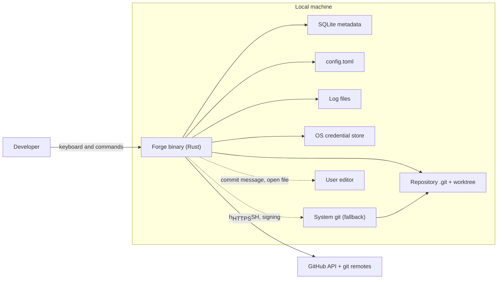
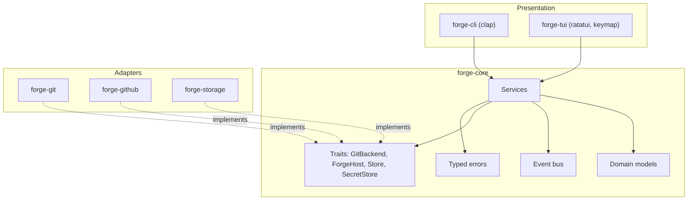
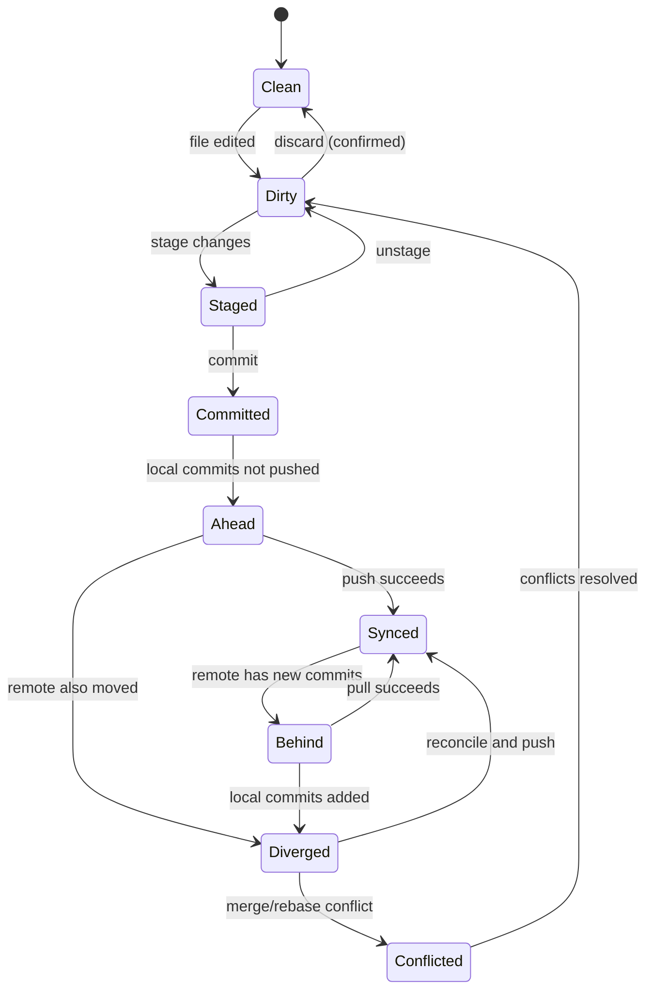

# 02 — Architecture

## System context

Forge talks to: the user (keyboard/commands), the local machine (repo, SQLite, `config.toml`, logs, OS keyring, system `git` as fallback, user editor) and GitHub (HTTPS API + git remotes). **There is no Forge-hosted backend.**



## Layers and dependency rules



- **Presentation** (`forge-cli`, `forge-tui`): parsing, rendering, input. **No Git, HTTP or SQL.**
- **Application core** (`forge-core`): services, domain models, event bus, error types. Depends only on traits → testable with fakes. **No I/O dependencies.**
- **Adapters** (`forge-git`, `forge-github`, `forge-storage`): concrete trait implementations.
- Direction: `presentation → core → adapters (via traits)`. Adapters never depend on presentation.

### Crate dependency graph

```
forge-cli (binary, composition root) → forge-core, forge-tui, forge-git, forge-github, forge-storage
forge-tui     → forge-core
forge-git     → forge-core
forge-github  → forge-core
forge-storage → forge-core
forge-core    → (no I/O crates)
```

## Services (all live in `forge-core`)

| Service | Responsibility | Notes |
|---|---|---|
| `RepositoryService` | Discovery, open/close, metadata, worktree detection | Bare repos, submodules, linked worktrees: explicitly supported or politely refused |
| `StatusService` | Staged, unstaged, untracked, conflicted, ignored | Debounced refresh driven by filesystem watcher |
| `DiffService` | File/hunk/line diff models; staged vs unstaged | Lazy loading; size limits for large/binary files |
| `CommitService` | Stage/unstage (file, hunk, line), commit, amend, history | Runs commit-message validator; honours repo hooks (doc 03) |
| `BranchService` | List, create, switch, rename, delete, merge | Refuses switch with conflicting dirty tree; offers stash |
| `RemoteService` | Fetch, pull, push, upstream tracking | Cancellable; emits progress events |
| `PullRequestService` | List, view, create, checkout, check status | Behind `ForgeHost` trait |
| `AuthService` | Device-flow login, token storage, expiry, logout | Token never touches SQLite or logs |
| `ProjectService` | Recent, favourites, per-project UI state | Prunes paths that no longer exist |
| `SafetyService` | Classifies operations by risk; creates recovery snapshots | Central confirmation policy (doc 07) |

## Traits (boundaries)

Define these in `forge-core`. Signatures below are **suggested shape**, not final — keep them async-friendly where they touch network, and cancellable.

```rust
// Suggested shape — adapt as needed, but keep the boundaries.
pub trait GitBackend: Send + Sync {
    // reads
    fn open(&self, path: &Path) -> Result<RepoHandle, GitError>;
    fn status(&self, repo: &RepoHandle) -> Result<StatusSnapshot, GitError>;
    fn diff(&self, repo: &RepoHandle, target: DiffTarget) -> Result<Diff, GitError>;
    fn log(&self, repo: &RepoHandle, page: LogPage) -> Result<Vec<CommitSummary>, GitError>;
    fn branches(&self, repo: &RepoHandle) -> Result<Vec<Branch>, GitError>;
    // writes
    fn stage(&self, repo: &RepoHandle, sel: StageSelection) -> Result<(), GitError>;
    fn unstage(&self, repo: &RepoHandle, sel: StageSelection) -> Result<(), GitError>;
    fn commit(&self, repo: &RepoHandle, req: CommitRequest) -> Result<CommitId, GitError>;
    // network ops take a CancellationToken + progress sink
    fn push(&self, repo: &RepoHandle, req: PushRequest, ctx: OpContext) -> Result<PushOutcome, GitError>;
    // ...
}

#[async_trait]
pub trait ForgeHost: Send + Sync {          // GitHub is the only impl in v1
    async fn current_user(&self) -> Result<HostUser, HostError>;
    async fn list_pull_requests(&self, repo: &RemoteRepo, f: PrFilter) -> Result<Vec<PullRequest>, HostError>;
    async fn create_pull_request(&self, repo: &RemoteRepo, new: NewPullRequest) -> Result<PullRequest, HostError>;
    async fn check_runs(&self, repo: &RemoteRepo, git_ref: &str) -> Result<Vec<CheckRun>, HostError>;
}

pub trait Store: Send + Sync { /* projects, state, cache, activity, guide progress */ }
pub trait SecretStore: Send + Sync { /* get/set/delete token; reports "unavailable" explicitly */ }
```

Also provide **in-memory fakes** of every trait in `forge-core` behind a `test-support` feature.

## TUI architecture note

Keep the **view-model layer separate from widgets** so view logic is unit-testable without a terminal. The UI thread reads immutable state snapshots and sends `Command`s; it never does I/O.

## Repository states Forge models

Used to decide which actions the footer offers.



## Supported repository kinds (opening a path)

| Kind | Behaviour |
|---|---|
| Not a repo | Show project browser; offer `git init` or clone |
| Normal | Fully supported |
| Linked worktree | Supported; label as worktree |
| Bare | Refuse working-tree views; history only |
| Has submodules | Open; show submodules **read-only** in MVP |
| Merge/rebase/bisect in progress | Show in-progress banner with continue / abort |
| Subdirectory of a repo | Resolve to repo root |
