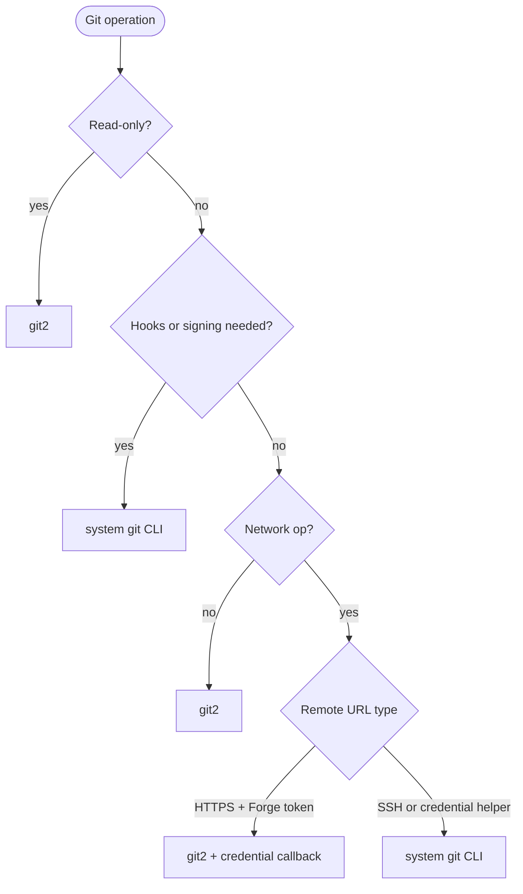
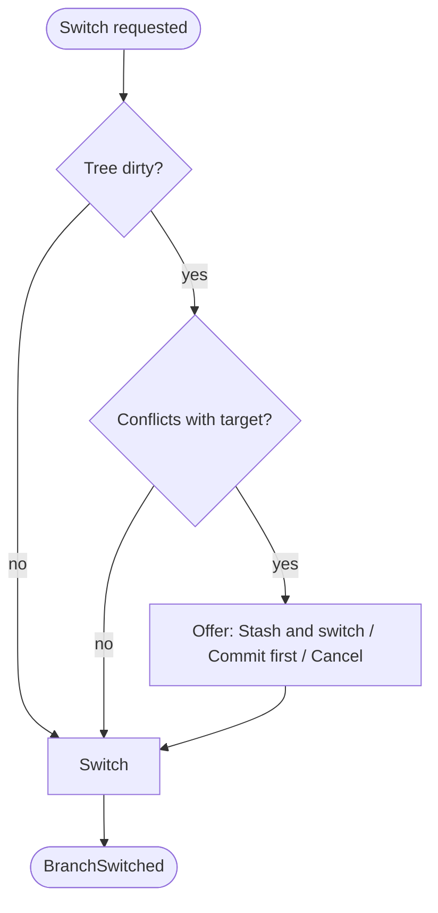
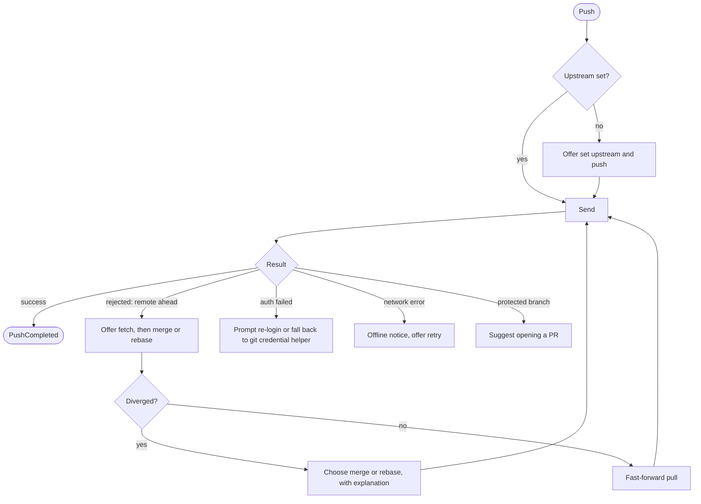

# 03 — Git Engine Strategy

Forge uses **libgit2 (`git2`)** for fast in-process reads and most writes, with a **deliberate, narrow fallback to the system `git` binary** where libgit2 is weaker. All Git access goes through the `GitBackend` trait so the implementation can change and UI logic can be tested with an in-memory fake. Record this decision (D2) and revisit as libgit2 evolves.

## Per-operation approach

| Operation | Approach | Reason |
|---|---|---|
| Status, diff, log, refs, branches | `git2` | Fast, structured, no process spawn |
| Stage/unstage files and hunks | `git2` (index + apply APIs) | Needs careful testing around line endings and partial hunks |
| Commit | `git2`; run hooks via `git` CLI when hooks exist | libgit2 doesn't run hooks. Recommended: honour `pre-commit` / `commit-msg` by shelling out |
| Fetch / push / pull | `git2` for HTTPS with Forge credentials; **CLI** for SSH agents, credential helpers, unusual configs | Users' existing SSH/credential setups must keep working |
| Merge, cherry-pick | `git2` for simple merges | Interactive rebase deferred beyond MVP (large, risky) |
| GPG/SSH commit signing | **CLI** | Respect user's `commit.gpgsign` |

## Decision flow

## Implementation rules

- **Shell-outs use argument arrays — never string-built shell commands.** Repo paths and branch names are untrusted input.
- Surface to the user when Forge is **about to execute a hook or external command** (malicious repo config/hooks/filters are a threat).
- Hooks: run by default via CLI, with a `git.run_hooks` setting to disable (D7, Open).
- Parse CLI output with machine-readable flags (`--porcelain=v2`, `-z`, `--format`) — never scrape human text.
- Keep the CLI fallback **narrow and documented**; every fallback site gets a comment citing which row above justifies it.
- Add **compatibility tests against real `git`** (same fixtures, compare results).

## Hunk & line staging (D8, Open)

Prototype with `git2` (apply to index). If edge cases (CRLF/line endings, renames, no-newline-at-EOF) fail fixture tests, fall back to generating a patch and using `git apply --cached`. Build fixtures first.

## Edge cases that must be handled explicitly

Detached HEAD · unborn branch (no commits yet) · repo with no remote · missing upstream · merge/rebase/bisect in progress · dirty tree on switch · large diffs · binary files · CRLF · submodules · linked worktrees · bare repos.

## Switching branches with a dirty tree

## Push failure handling

