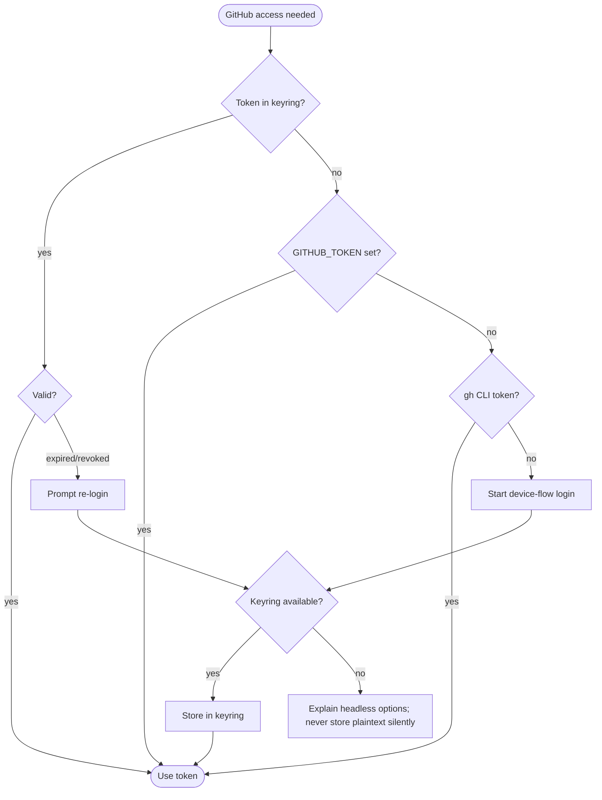
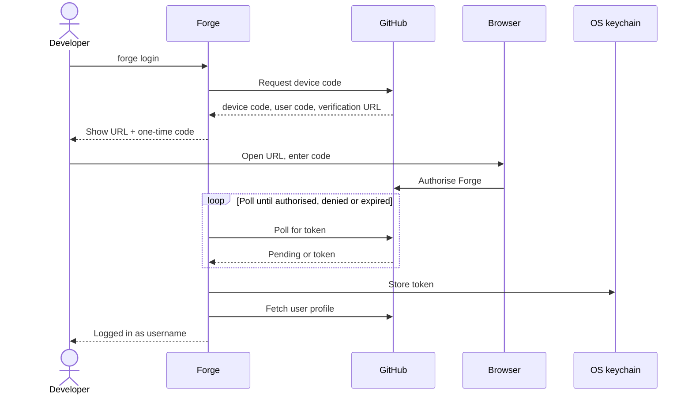
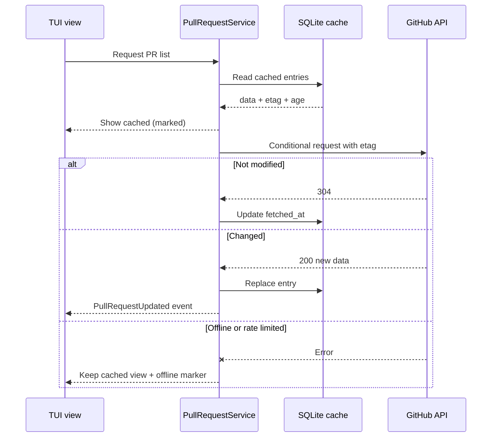

# 04 — GitHub Integration

All GitHub access lives in `forge-github` behind the `ForgeHost` trait (D14). GitHub is the only implementation in v1; do not leak GitHub-specific types into `forge-core` services.

## Authentication

### Current scaffold behavior

`forge login` currently delegates the interactive device flow to the GitHub CLI
by running `gh auth login`; Forge does not read or store the token itself.
GitHub CLI must be installed and available on `PATH`. Normal Forge startup
checks `gh auth status` and requires a logged-in account. Native
`AuthService`/keyring integration and the app-type decision in D3 remain future
work.

Multiple GitHub.com accounts are managed through `gh`: `forge account list`
shows saved accounts and the active account, `forge account add` starts another
GitHub CLI login, and `forge account use USERNAME` selects a saved account.
Forge does not copy or store account tokens.

- **Flow:** OAuth **device flow**. Request device code → show verification URL + one-time code → poll until authorised/denied/expired → store token in OS keyring → fetch profile → "Logged in as NAME".
- **Scopes:** minimum for MVP (repo access for PRs and checks). Document each scope and why.
- **App type (D3, Open):** evaluate a *GitHub App with expiring user tokens* vs an *OAuth App*. Keep PAT and `gh` token as fallbacks. Implement behind `AuthService` so the choice is swappable.
- **Fallbacks** (clearly marked in UI/`doctor`): `GITHUB_TOKEN` env var; reuse `gh` CLI token.
- **Failure handling:** expired/revoked token → explicit re-login prompt, never silent failure. **Keyring unavailable** (headless Linux) → explicit error listing alternatives; **no silent plaintext fallback**.

### Credential resolution order

### Login sequence

## API usage

- **REST for MVP:** repository, pull request (list, detail, create), review-state summary, check runs and statuses. GraphQL later only where it reduces request counts.
- **Later (post-MVP):** issues, Actions workflow runs + logs, comments.
- **Conditional requests** with `ETag` / `If-None-Match` to save rate limit and bandwidth.
- **Respect rate-limit headers**; back off automatically; surface remaining quota in `forge doctor`.
- **Pagination** handled in the client; the UI streams results in as they arrive.
- Client choice (D4, Open): start with hand-rolled `reqwest` + a small typed surface; adopt Octocrab if model maintenance becomes costly.
- Never log tokens; redact by construction (wrapper type that doesn't implement `Debug`/`Display` of the secret).

## Caching & offline (stale-while-revalidate)

- Cache selected responses in SQLite (`github_cache`) with `fetched_at` and `etag`.
- Show **stale data immediately**, marked as cached, then refresh in background.
- **Offline mode:** all local Git features keep working; GitHub views show cached data with an "offline, last updated …" marker.

## PR workflow (end to end)

`stage → commit → push → CreatePullRequest command → POST PR → PullRequestOpened event → record activity + cache PR`. Pushing to a **protected branch** that is rejected should suggest opening a PR.

> **Implementation note (2026-10-12):** the Pull requests screen reads GitHub through the GitHub CLI rather than native REST calls for now. See `docs/adr/0003-pull-requests-through-github-cli.md`.
