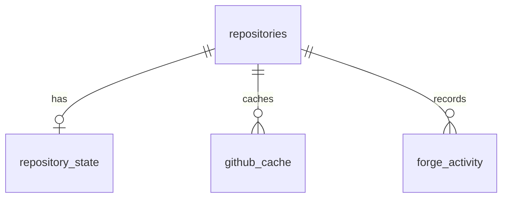

# 05 — Data & Storage

## Source of truth

| Data | Source of truth | Examples |
|---|---|---|
| Git history/state | `.git` | commits, branches, refs, HEAD, index, tags |
| GitHub collaboration | GitHub | PRs, issues, reviews, Actions |
| Forge metadata | SQLite | recent projects, favourites, guide progress, activity |
| Preferences | `config.toml` | theme, keybindings, editor, defaults |
| Credentials | OS keychain | GitHub token |

**Never copy Git history into SQLite.** GitHub data in SQLite is a *cache*, always re-derivable.

## SQLite schema (proposed — implement as migration 0001)

```sql
CREATE TABLE repositories (
  id              INTEGER PRIMARY KEY,
  path            TEXT NOT NULL UNIQUE,   -- canonicalised absolute path
  github_owner    TEXT,
  github_repo     TEXT,
  last_opened_at  INTEGER NOT NULL,       -- unix seconds
  is_favorite     INTEGER NOT NULL DEFAULT 0
);

CREATE TABLE repository_state (
  repository_id       INTEGER PRIMARY KEY REFERENCES repositories(id) ON DELETE CASCADE,
  last_branch         TEXT,
  last_view           TEXT,
  last_selected_file  TEXT
);

CREATE TABLE github_cache (
  repository_id  INTEGER NOT NULL REFERENCES repositories(id) ON DELETE CASCADE,
  resource_type  TEXT NOT NULL,           -- pull_request, check_run, ...
  resource_id    TEXT NOT NULL,
  data           TEXT NOT NULL,           -- JSON
  etag           TEXT,
  fetched_at     INTEGER NOT NULL,
  PRIMARY KEY (repository_id, resource_type, resource_id)
);

CREATE TABLE forge_activity (
  id             INTEGER PRIMARY KEY,
  repository_id  INTEGER NOT NULL REFERENCES repositories(id) ON DELETE CASCADE,
  action         TEXT NOT NULL,           -- event name, e.g. CommitCreated
  metadata       TEXT,                    -- JSON
  created_at     INTEGER NOT NULL
);
CREATE INDEX idx_activity_repo_time ON forge_activity(repository_id, created_at DESC);

CREATE TABLE guide_progress (
  guide_id      TEXT NOT NULL,
  step          TEXT NOT NULL,
  completed_at  INTEGER,
  PRIMARY KEY (guide_id, step)
);

CREATE TABLE schema_migrations (version INTEGER PRIMARY KEY, applied_at INTEGER NOT NULL);
```



## Storage rules

- **Versioned migrations run at startup.** Enable `PRAGMA foreign_keys = ON`.
- DB lives in the **platform data directory** (`directories` crate).
- Activity is **retention-limited** (e.g. 90 days or latest N rows per repo).
- **All writes happen off the UI thread** (persistence task fed by the event channel).
- **Corrupt DB → move aside and recreate** rather than crash. Nothing in it is irreplaceable.
- `ProjectService` prunes repository rows whose paths no longer exist.
- Token **never** stored in SQLite, config, or logs.

## Platform directories

Use `directories::ProjectDirs` for config, data, cache, **state** (logs) locations — never hard-code `~/.forge`. Log files go in the state dir with rotation.

## `config.toml` (illustrative — all keymap entries rebindable)

```toml
[ui]
theme = "forge-dark"
diff_mode = "unified"        # or "side-by-side"
confirm_destructive = true

[git]
editor = "nvim"
run_hooks = true
fetch_on_open = true

[github]
fetch_interval_secs = 120

[keys]
stage = "s"
commit = "c"
```

Rules: unknown keys warn (don't crash); invalid values fall back to defaults with a `doctor`-visible warning; `confirm_destructive = false` must still keep dangerous-tier (force push, history rewrite) typed confirmation.
