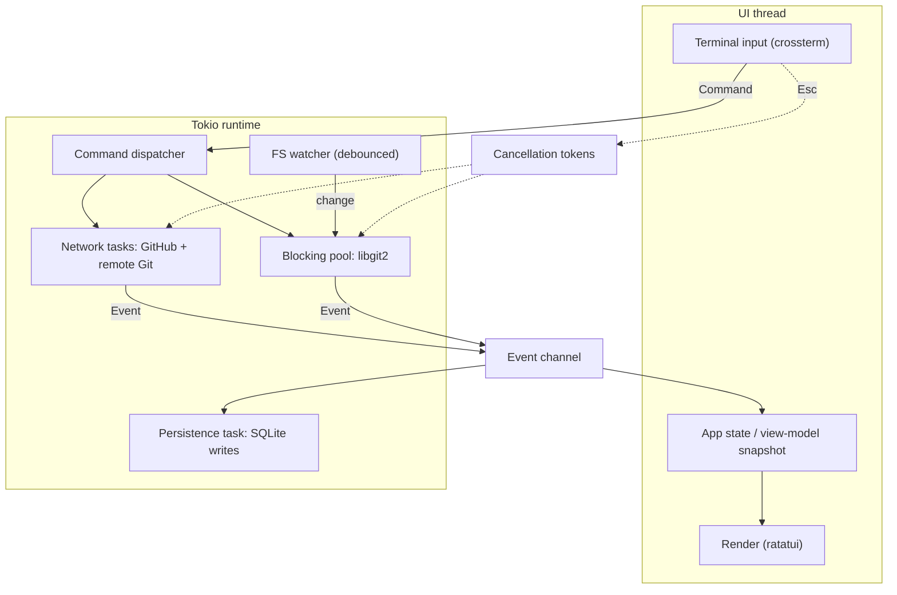
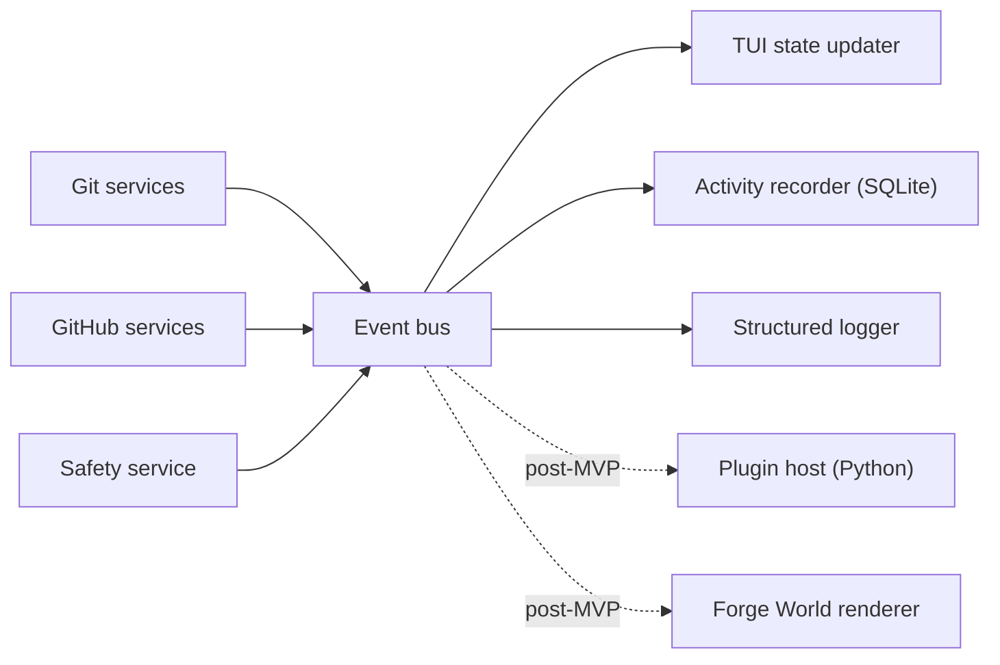

# 06 — Events & Concurrency

## Concurrency model

- A dedicated **UI thread** owns terminal I/O and rendering. It reads **immutable state snapshots** and sends **Commands**. It never does I/O.
- A **Tokio runtime** handles network and long-running tasks. Blocking Git (libgit2) operations run on a **bounded blocking pool**.
- Tasks communicate through **channels**. Every long task has a **cancellation token** and emits **progress events**. `Esc` cancels.
- A **debounced filesystem watcher** (`notify`) triggers status refreshes so the TUI reflects edits made elsewhere.
- Rendering is **event-driven** with a light tick for spinners/animations — **not a busy loop**.

## Commands vs events

- **Commands** = requests (`StageFile`, `Commit`, `Push`, `CreatePullRequest`). UI → core.
- **Events** = facts that already happened (`CommitCreated`). Core → everyone.
- Don't mix them: never emit an event for something that hasn't happened; never treat an event as a request.

## Event catalogue (initial)

| Category | Events |
|---|---|
| Repository | `RepositoryOpened`, `RepositoryClosed`, `StatusChanged` |
| Index & commits | `FileStaged`, `FileUnstaged`, `HunkStaged`, `CommitCreated`, `CommitAmended` |
| Branches | `BranchCreated`, `BranchSwitched`, `BranchDeleted`, `MergeCompleted`, `ConflictDetected` |
| Remote | `FetchStarted`, `FetchCompleted`, `PushStarted`, `PushProgress`, `PushCompleted`, `PushRejected` |
| GitHub | `Authenticated`, `TokenExpired`, `PullRequestOpened`, `PullRequestUpdated`, `ChecksChanged` |
| Safety | `DestructiveActionConfirmed`, `RecoverySnapshotCreated` |

## Event contract

- Typed Rust **enums**, with a **versioned, `serde`-serialisable** form, so later consumers (Python plugins, Forge World) need no Git internals.
- Include repository context (repo id/path) on every event.
- Events should be **replayable** (needed for Forge World).
- Adding an event is cheap; **renaming/removing** is a breaking change → version bump + note.

## Event bus fan-out

Consumers in MVP: TUI updater, activity recorder, structured logger. Keep the bus a simple broadcast abstraction so post-MVP consumers attach without touching producers.

## Rules of thumb for the implementing agent

- A slow consumer must not stall producers (bounded channels + drop/coalesce policy for progress events).
- Coalesce `StatusChanged` bursts from the watcher (debounce).
- Cancellation must leave the repo in a consistent state; cancelled ops emit a terminal event.
- No `unwrap()` on channel sends in app code paths; handle closed receivers on shutdown.
