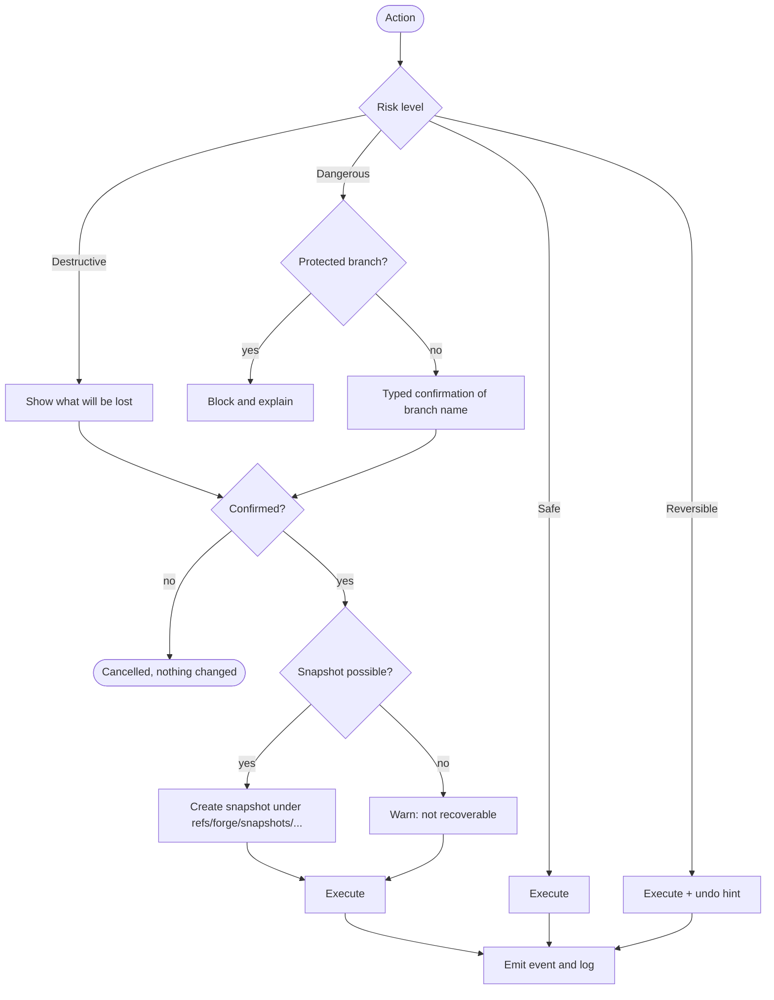
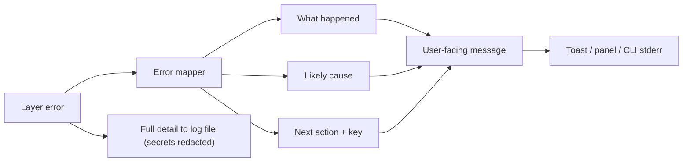

# 07 — Safety Model, Errors & Observability

## Risk levels

| Level | Examples | Policy |
|---|---|---|
| **Safe** | status, diff, log, fetch, stage | No confirmation |
| **Reversible** | commit, switch branch, merge, amend (unpushed) | No confirmation; **undo hint** in toast |
| **Destructive** | discard changes, hard reset, delete branch, delete untracked | **Preview of what will be lost**, explicit confirm, **automatic recovery snapshot** where possible |
| **Dangerous** | force push, history rewrite on pushed commits | **Typed confirmation (branch name)**, prefer `--force-with-lease`, **block on protected branches** |

All classification and confirmation policy lives in **`SafetyService`** — presentation layers ask it; they don't decide.

## Recovery snapshots (proposed feature, D9)

Before a destructive local action, record recoverable state — e.g. a stash-like commit stored under a Forge-owned ref namespace `refs/forge/snapshots/...` — so discarded work can be restored from an **"Undo" list**. Prune by age and count. Emit `RecoverySnapshotCreated`.

Open questions to validate with fixtures: stash-style commits under `refs/forge/` vs a separate object store; cost on repos with large/binary files (D9 "revisit if"). Untracked files need explicit handling.

## Other safety requirements

- Terminal state restored on **crash, panic or signal** (panic hook + signal handler + RAII guard).
- TUI **never freezes on network failure**.
- Detect repos mid-**merge/rebase/bisect** and handle explicitly (banner with continue/abort).
- **Dry-run** output for state-changing CLI operations where practical.
- Dedicated tests prove destructive actions require confirmation and snapshots restore correctly.

## Error handling

**Typed errors per layer:** `GitError`, `GitHubError` (`HostError`), `StorageError`, `AuthError`. An **error mapper** converts them into a three-part user-facing error:

1. **What happened**
2. **Likely cause**
3. **Suggested next step** (with key binding in the TUI)

> Example: *Push rejected: the remote has commits you do not have. Fetch and merge or rebase first. [f] Fetch now.*

**Cases that must be handled well:** rejected push · merge conflict · dirty worktree on switch · missing upstream · expired token · no network · rate limited · detached HEAD · unborn branch · repo with no remote · large diff.

CLI: non-zero exit codes on failure; human message on stderr; `--json` errors keep a stable shape.

## Logging & diagnostics

- Structured logs via **`tracing`** to a **file** in the platform state dir, with rotation. **Never** printed into the TUI or normal CLI output.
- **Tokens and secrets are redacted by construction** (newtype wrappers; no `Debug` leak).
- `forge doctor` + `--debug` flag.
- **Panic hook** restores the terminal and writes a crash report, printing the path to share.

### `forge doctor` should report

Git version · system `git` availability (for fallbacks) · credential source and validity · keyring availability · config parse status · DB status/migration version · terminal capabilities (colour depth, size, unicode) · GitHub rate-limit remaining · log file location.
