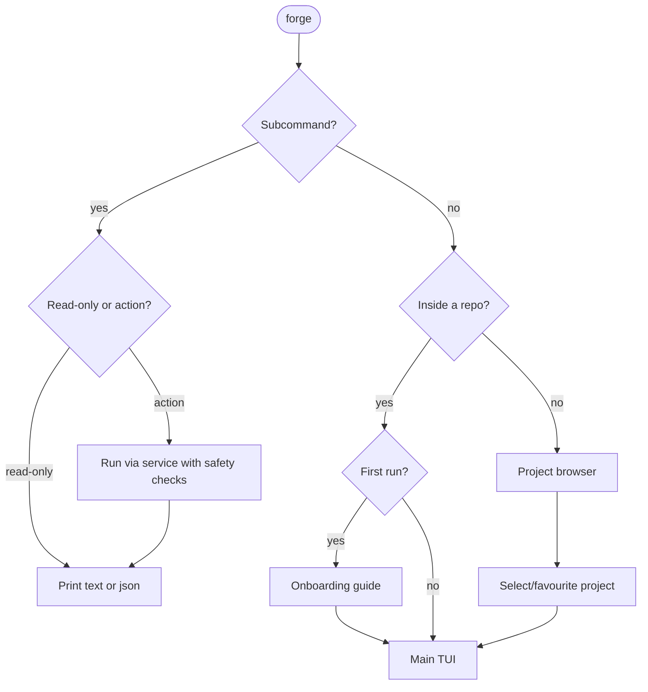
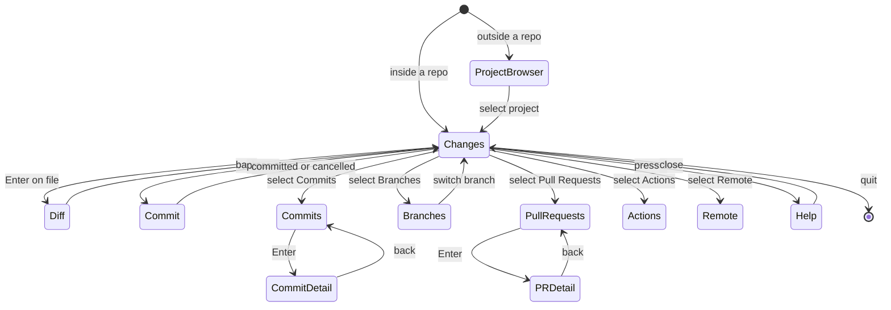

# 08 — CLI & TUI Specification

## Command surface

| Command | Behaviour | Output modes |
|---|---|---|
| `forge` | Open TUI for current repo, or project browser if outside a repo | TUI |
| `forge login` / `logout` | GitHub device-flow auth; remove stored credential | Text |
| `forge projects` | Browse recent + favourite projects | TUI or list |
| `forge status` | Working-tree state with branch/upstream info | Text, `--json`, `--tui` |
| `forge branch` / `branch create NAME` / `switch NAME` / `delete NAME` | Branch manager or immediate action | TUI or text |
| `forge commit "MSG"` | Commit staged changes; opens editor or in-TUI composer if no message | Text |
| `forge push` / `pull` / `fetch` | Remote sync with progress | Text with progress |
| `forge pr` / `pr list` / `pr create` / `pr view N` | PR view or direct actions | TUI, text, `--json` |
| `forge guide` / `forge help [topic]` | Interactive tutorial; topic help | TUI or text |
| `forge doctor` | Diagnose environment | Text |

### CLI conventions

- Non-zero exit codes on failure.
- `--json` on **read** commands; **stable output contracts** for anything marked `--json` (define serde structs, add schema/snapshot tests, version them).
- `--no-color` and `NO_COLOR` respected.
- `--repo PATH` targets another repo.
- State-changing commands support `--dry-run` where practical.
- Shell completions (bash, zsh, fish, PowerShell) and a man page generated from the Clap definitions.

### Launch routing



## TUI layout

```
+-- FORGE ---------------------------------------------------------------+
| ~/projects/example   main   ^2 v0   (synced 2m ago)    @github-user    |
+------------------+----------------------+-----------------------------+
| REPOSITORY       | CHANGES              | DIFF                        |
|                  |                      |                             |
| > Changes     3  | M src/cache.rs       | - old implementation        |
|   Commits        | M src/routes.rs      | + new implementation        |
|   Branches       | + tests/cache.rs     |                             |
|   Pull Requests  |                      |                             |
|   Actions        |                      |                             |
|   Remote         |                      |                             |
+------------------+----------------------+-----------------------------+
| [s] Stage [c] Commit [p] Push [b] Branch [/] Search [?] Help          |
+-----------------------------------------------------------------------+
```

**Layout rules**
- Three panes: navigation (left), list (centre), detail/diff (right).
- **Responsive:** below ~100 cols show two panes; below ~70 show one with breadcrumb navigation. **Must work at 80x24.**
- **Header always shows:** repo path, branch, ahead/behind, last-fetch age, authenticated user.
- **Footer is contextual:** only actions valid for the focused view *and* selection.
- A status line / toast area reports async progress and results without blocking input.
- Actions/Issues-style views that are post-MVP should be hidden or clearly "coming soon", not broken.

## Default keymap (all rebindable in `config.toml`)

| Context | Keys |
|---|---|
| Global | `?` help · `/` search · `Tab`/`Shift+Tab` cycle panes · `h j k l` or arrows move · `q` back/quit · `Ctrl+C` safe exit · `:` command palette |
| Changes | `s` stage · `u` unstage · `a` stage all · `d` discard (confirm) · `Enter` open diff · `c` commit · `e` open in editor |
| Diff | `Space` stage/unstage hunk · `v` select lines · `n`/`N` next/prev hunk · `t` toggle unified/side-by-side |
| Branches | `Enter` switch · `n` new · `r` rename · `D` delete (confirm) · `m` merge into current |
| Remote | `f` fetch · `P` push · `p` pull · `o` open on GitHub |
| Pull requests | `n` new · `Enter` view · `o` open in browser · `r` refresh · `x` checkout PR branch |

Keybinding conflicts: the keymap module must detect and report duplicates within one context.

## Navigation states



## UX principles

- **Never block input.** Background ops with visible progress; `Esc` cancels.
- **Local vs remote always labelled** (remote marker + freshness timestamp).
- **Errors say what happened, why, and what to do next.**
- **Previews before consequences** (discard, reset, force push, branch delete show exactly what's lost).
- **Progressive disclosure:** beginners see few actions; advanced ones live behind the command palette (`:`).
- **Accessibility:** colour-blind-safe default theme; **no meaning by colour alone** (add glyphs/labels); high-contrast theme; `NO_COLOR` respected.

## Integrated guide

- **First run:** short onboarding — login, choose repo, see changes, stage, commit, push, open PR. Progress stored in `guide_progress` (resumable).
- **Contextual help:** footer, `?` overlay and `forge help TOPIC` all draw from **one shared help-content source**.
- **Stretch:** *Practice mode* (sandbox temp repo) and *Explain mode* (show the equivalent raw Git command: "Forge ran: `git switch -c feat/x`").
