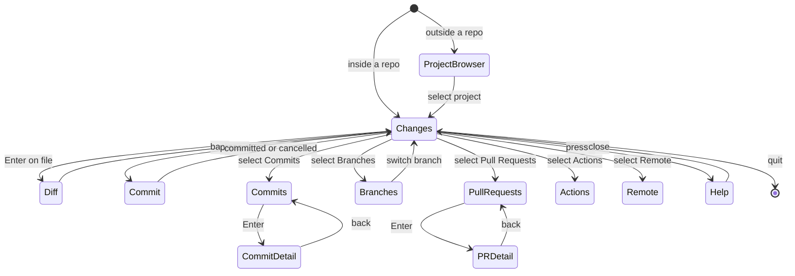

# 08 — CLI & TUI Specification

## Command surface

| Command | Behaviour | Output modes |
|---|---|---|
| `forge` | Open TUI for current repo, or project browser if outside a repo | TUI |
| `forge login` / `logout` | GitHub device-flow auth; remove stored credential | Text |
| `forge account list|add|use USERNAME` | List, add, or activate a GitHub CLI account | Text |
| `forge projects` | List repositories available to the authenticated GitHub account | Text |
| `forge status` | Working-tree state with branch/upstream info | Text, `--json`, `--tui` |
| `forge branch` / `branch create NAME` / `switch NAME` / `delete NAME` | Branch manager or immediate action | TUI or text |
| `forge commit "MSG"` | Commit staged changes; opens editor or in-TUI composer if no message | Text |
| `forge push` / `pull` / `fetch` | Remote sync with progress | Text with progress |
| `forge pr` / `pr list` / `pr create` / `pr view N` | PR view or direct actions | TUI, text, `--json` |
| `forge guide` / `forge help [topic]` | Interactive tutorial; topic help | TUI or text |
| `forge doctor` | Diagnose environment | Text |

### CLI conventions

- Non-zero exit codes on failure.
- `--json` on **read** commands; **stable output contracts** for anything marked `--json` (define serde structs, add schema/snapshot tests, version them).
- `--no-color` and `NO_COLOR` respected.
- `--repo PATH` targets another repo.
- State-changing commands support `--dry-run` where practical.
- Shell completions (bash, zsh, fish, PowerShell) and a man page generated from the Clap definitions.

### Launch routing


## TUI layout

```
+-- FORGE ---------------------------------------------------------------+
| ~/projects/example   main   ^2 v0   (synced 2m ago)    @github-user    |
+------------------+----------------------+-----------------------------+
| REPOSITORY       | CHANGES              | DIFF                        |
|                  |                      |                             |
| > Changes     3  | M src/cache.rs       | - old implementation        |
|   Commits        | M src/routes.rs      | + new implementation        |
|   Branches       | + tests/cache.rs     |                             |
|   Pull Requests  |                      |                             |
|   Actions        |                      |                             |
|   Remote         |                      |                             |
+------------------+----------------------+-----------------------------+
| [s] Stage [c] Commit [p] Push [b] Branch [/] Search [?] Help          |
+-----------------------------------------------------------------------+
```

**Layout rules**
- **Projects root:** `FORGE_PROJECTS_DIR` if set, else `~/projects` if it exists, else the folder `forge` is launched from (never the bare home folder). Repositories are read on 8 background threads and appear as they load (title shows `reading N/M`); repositories Git cannot read are skipped and counted as "unreadable" instead of failing the scan.
- **Projects browser:** `forge` scans the projects root recursively for local Git repositories and opens the "Projects home" screen from the design canvas (artboard 18): a rounded window with a title bar (`FORGE`, root path, repository count, how many need attention — dirty or behind upstream — and the active `@login`), a project table grouped by parent folder (columns: cursor, `1–9` jump key, project, `⎇` branch, `↑ahead ↓behind`, dirty count, CI, last-commit age), a detail pane (path, branch, remote, changes, CI, recent commits, "Open with"), and a key-hint bar. `↑`/`↓` or `j`/`k` moves, `1`–`9` jumps, `/` filters (`Enter` keeps, `Esc` clears), `Tab` cycles the `all`/`dirty`/`behind` scope chips, `Enter` opens the project, `@` opens the account switcher, `q` or `Ctrl+C` exits.
- **Account switcher (`@`):** an overlay listing GitHub CLI accounts for github.com (active one marked `●`). `↑`/`↓` moves, `Enter` makes the selected account active via `gh auth switch` (on a background thread; the title bar's `@login` updates on success), `Esc` closes. Errors stay in the overlay. Adding an account needs an interactive login, so the overlay points to `forge account add` in a shell. The design canvas has no artboard for this; `@` was chosen because the design reserves `a` for staging. CI shows `· not fetched` until GitHub checks are wired up; pinning, fetch-all, clone, grouping and open-in-new-tab from the design are not built yet. `Enter` opens the project's Changes screen; `Esc` there returns to the list.
- **Changes (artboard 01 · stage by hunk):** title bar (path, `⎇ branch`, `↑ahead ↓behind` when tracking, `@login`); a **Repository** nav column (Changes with changed-file count, Commits, Branches with count, Pull Requests, Remote — Changes is live, Commits opens with `l` and Branches with `b`; Actions is out of MVP and not shown); a files pane with **Staged · n** and **Unstaged · n** lists (status glyph `M + D R C T ? U`, dimmed directory, `+added −removed` or `bin`) and a **Summary** (files, line totals, last-fetch age from `FETCH_HEAD`); and a diff pane titled `Diff · hunk i of n` (`· staged` for index diffs) showing line numbers, `+`/`-` signs and a `▌` gutter on the selected hunk. The focused pane's headings are cyan and prefixed `▸`, so focus is visible under `NO_COLOR`. All Git work runs on background threads; a status line shows `◐ staging…` and then `✓ result` or `✕ what failed · cause · next step`.
  - Keys: `↑↓`/`j k` move the file cursor (files pane) or the selected hunk (diff pane); `Tab`/`Shift+Tab` switch panes, `Enter` jumps to the diff; `PgUp`/`PgDn` or `Ctrl+U`/`Ctrl+D` scroll a long hunk; `s` stages the selected hunk (whole file for untracked, conflicted, renamed or binary files); `a` stages the file (also marks a conflict resolved); `u` unstages — the selected hunk when the diff pane is focused, otherwise the file; `x` discards — the selected hunk from the diff pane, the whole file from the files pane (untracked files are deleted); `r` refreshes; `c` opens Commit; `Esc` returns to Projects; `q`/`Ctrl+C` quit. The key bar lists only keys valid for the selection (`u` for staged rows; `s a x` for unstaged rows) and drops trailing hints that do not fit.
  - Discard is destructive: a red dialog previews what is lost (`+a −r` lines and up to six changed lines of the hunk), only `y` confirms (`Enter` does not), `Esc`/`n` cancel. Before touching the file, Forge commits its current content to `refs/forge/snapshots/<unix-ms>` using a temporary index (the real index is untouched); the result line shows the `git checkout <ref> -- <path>` undo command. If the snapshot fails, nothing is discarded. See ADR 0002.
  - Responsive: three panes from 100 columns, files + diff from 60 (including 80x24), only the focused pane below 60.
  - Not built yet (later design screens): `v` split diff (16), `/` search (08), `?` help (10/14), the stash list, the CI chip and an Undo list for snapshots.
- **Commits (artboard 03 · graph log):** opened with `l` from Changes; `Esc` returns. Left pane **Commits · all branches · n** (`+` when older commits exist): one row per `git log --graph` line — lanes redrawn with `│ ● / \` in a colour per lane, short hash, ref chips (`[⎇ main]` checked-out branch, `[feat/x]` branch, `[origin/main]` remote, `[tag: v1]`), subject, author and age (author hidden below 64 columns, chips and subject shrink first). Lines that only connect lanes are shown but the cursor skips them. Right pane **Commit \<hash\>** (from 100 columns; below that `Enter` swaps it with the list and `Esc` swaps back): subject, full hash, author and email, UTC date with age, parents (`(merge)` flagged), refs, message body, and **Files · n** with `+added −removed` / `bin` per file. A merge lists what it brought in over its first parent. `j`/`k` or arrows move, `PageUp`/`PageDown` jump 10 commits, `g`/`G` (or `Home`/`End`) go to the newest/oldest loaded, `a` toggles all branches (local, remote, tags, `HEAD`; Forge's own `refs/forge/*` snapshots are left out) and the current branch, `r` refreshes, `q` quits.
  - History is read with `git log --graph --decorate=full` in pages of 300 on a background thread; moving within 10 commits of the end of a full page fetches the next page and keeps the cursor on the same commit. A repository with no commits shows "No commits yet" rather than an error. Commit ids are validated as hex before reaching a command line. Not built yet: search (screen 08), checkout/cherry-pick from a commit, and scrolling a long file list in the detail pane.
- **Branches & worktrees (artboard 04):** opened with `b` from Changes; `Esc` returns and Changes re-reads the repository. Left pane: **Local · n** (the checked-out branch first, then newest) and **Remote · n**; each row shows a cursor, `●` on the current branch, name, upstream state (`in sync`, `↑a`, `↓b`, `↑a ↓b`, `local` = no upstream, `gone` = upstream deleted, `worktree` = held by another worktree), age and tip subject. A detached HEAD is named in the Local heading. Right pane (from 100 columns; below that `Tab` swaps it with the list): tip, UTC date, upstream, **vs HEAD** (`every commit is already in main`, `3 commits are not in main`) and the folder of any other worktree holding it, then **Worktrees · n** (path and branch, `●` for this folder; add/remove worktree is not built).
  - Keys: `j`/`k`, arrows, `PageUp`/`PageDown`, `g`/`G` move; `Enter` switches; `n` creates a branch starting at the selected one (a remote branch works too); `R` renames a local branch (prefilled); `x` deletes a local branch; `r` refreshes; `Tab` toggles the detail on narrow terminals; `q` quits. Letters are text while a name dialog is open.
  - **Switching with uncommitted changes** opens a dialog: `s` stashes tracked changes (`git stash push -m "forge: before switching to X"`), switches, and says `git stash pop` restores them — if the switch then fails the stash is popped straight back; `c` carries the changes over and lets Git refuse when they would be overwritten; `Esc` cancels. Untracked files are neither counted nor stashed. Switching to a remote branch creates a local branch tracking it (or uses the existing local one); a branch held by another worktree is explained instead of attempted.
  - **Delete is guarded:** only local branches; never the checked-out branch or one held by another worktree; remote branches point to `git push <remote> --delete <name>` instead. A red dialog says whether every commit is already in HEAD (`git branch -d`) or how many would be lost (`git branch -D`, only after `y`; `Enter` does not confirm). The result line always carries `Undo with: git branch <name> <full hash>`. Names are checked in the dialog (no spaces, `..`, `~^:?*[\`, leading `-`, `.lock`, …) and again by Git; a taken name is refused.
  - Not built: merge, fetch/prune, set-upstream, adding or removing worktrees, filtering. Merge is outside the MVP table in docs/10.
- **Commit (artboard 02 · compose message):** opened with `c` from Changes. Left pane: **Staged · n** files and **Hooks** — the installed commit hooks (`pre-commit`, `prepare-commit-msg`, `commit-msg`, `post-commit`, honouring `core.hooksPath`) with one shared state (`· runs on commit`, `◐ running`, `✓ passed`, `✕ failed`, `– skipped`) and the last lines of live hook/git output. Git runs the hooks itself, so Forge cannot say which tool inside a hook failed. Right pane: **Commit message** with type chips (`feat fix refactor perf docs chore`; the chip matching the subject's `type(scope)!:` prefix is highlighted, choosing one rewrites the prefix and keeps the scope, "no type" is allowed), a Subject box with an `n/72` counter (amber over 50, red over 72), a Body box, **Trailers** parsed from the body's last paragraph (`Refs: #42`, `Co-authored-by: …` — typed as body lines), and toggles `☐ amend ☐ sign ☐ push ☐ skip hooks`.
  - Focus moves with `Tab`/`Shift+Tab` through Type → Subject → Body → Options (`▸` and cyan mark the focused row; the text cursor shows in the focused box). Letters are text inside Subject/Body; they act as commands only on the Type row (`t`/`→`/`Space` next type, `←` previous) and the Options row (`←→` + `Space`, or `e` amend, `g` sign, `p` push, `n` skip hooks). `Enter` in Subject moves to Body; in Body it inserts a line. **`Ctrl+S` commits** (`Ctrl+Enter`/`Ctrl+J` also work where the terminal sends them). `Esc` cancels and keeps the draft for the next `c`. `Ctrl+P` is not bound here so it stays free for the project switcher (screen 19); push is the `push` toggle instead.
  - Commit runs `git commit --cleanup=whitespace -F <file in .git>` on a background thread; `-S`/`--no-gpg-sign` are passed only when `sign` differs from `commit.gpgsign`, `--no-verify` only when `skip hooks` is on (off by default). Validation explains what to do: no subject, nothing staged (unless amending), or push with no remote. On failure the message is kept and the status line shows the last output lines. Amend loads the last commit's message when the fields are empty and warns (red) when HEAD is already on a remote branch. With `push` on, Forge then runs `git push` (or `git push --set-upstream origin HEAD` when there is no upstream) with `GIT_TERMINAL_PROMPT=0`, so credentials must come from a helper; a push failure is reported without undoing the commit. The screen then returns to Changes with `✓ Committed <hash> <subject>.` and reloads.
  - Responsive: the staged/hooks pane is hidden below 70 columns.
- **Responsive:** the browser shows the list and selected-project detail side by side from 70 columns (including 80x24) and drops the branch column, then the detail pane, as width shrinks.
- Three panes: navigation (left), list (centre), detail/diff (right).
- Repository views: below ~100 cols show two panes; below ~70 show one with breadcrumb navigation. **Must work at 80x24.**
- **Header always shows:** repo path, branch, ahead/behind, last-fetch age, authenticated user.
- **Footer is contextual:** only actions valid for the focused view *and* selection.
- A status line / toast area reports async progress and results without blocking input.
- Actions/Issues-style views that are post-MVP should be hidden or clearly "coming soon", not broken.

## Default keymap (all rebindable in `config.toml`)

| Context | Keys |
|---|---|
| Global | `?` help · `/` search · `Tab`/`Shift+Tab` cycle panes · `h j k l` or arrows move · `q` back/quit · `Ctrl+C` safe exit · `:` command palette |
| Changes | `l` open Commits · `b` open Branches · `s` stage hunk · `a` stage file · `u` unstage · `x` discard (confirm with `y`) · `r` refresh · `Enter` open diff · `c` commit · `e` open in editor *(later)* — follows design artboard 01, replacing the earlier `d`/`Space` proposal |
| Commit | `Tab`/`Shift+Tab` field · `Ctrl+S` (or `Ctrl+Enter`) commit · `t`/`←→` type (Type row) · `e` amend · `g` sign · `p` push after · `n` skip hooks (Options row) · `Esc` cancel, keep draft |
| Diff | `j`/`k` next/prev hunk · `s`/`u`/`x` act on the selected hunk · `PgUp`/`PgDn` scroll · `v` split diff *(16)* · line selection *(later)* |
| Branches | `Enter` switch · `n` new · `r` rename · `D` delete (confirm) · `m` merge into current |
| Remote | `f` fetch · `P` push · `p` pull · `o` open on GitHub |
| Pull requests | `n` new · `Enter` view · `o` open in browser · `r` refresh · `x` checkout PR branch |

Keybinding conflicts: the keymap module must detect and report duplicates within one context.

## Navigation states



## UX principles

- **Never block input.** Background ops with visible progress; `Esc` cancels.
- **Local vs remote always labelled** (remote marker + freshness timestamp).
- **Errors say what happened, why, and what to do next.**
- **Previews before consequences** (discard, reset, force push, branch delete show exactly what's lost).
- **Progressive disclosure:** beginners see few actions; advanced ones live behind the command palette (`:`).
- **Accessibility:** colour-blind-safe default theme; **no meaning by colour alone** (add glyphs/labels); high-contrast theme; `NO_COLOR` respected.

## Integrated guide

- **First run:** short onboarding — login, choose repo, see changes, stage, commit, push, open PR. Progress stored in `guide_progress` (resumable).
- **Contextual help:** footer, `?` overlay and `forge help TOPIC` all draw from **one shared help-content source**.
- **Stretch:** *Practice mode* (sandbox temp repo) and *Explain mode* (show the equivalent raw Git command: "Forge ran: `git switch -c feat/x`").
