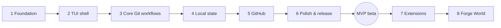
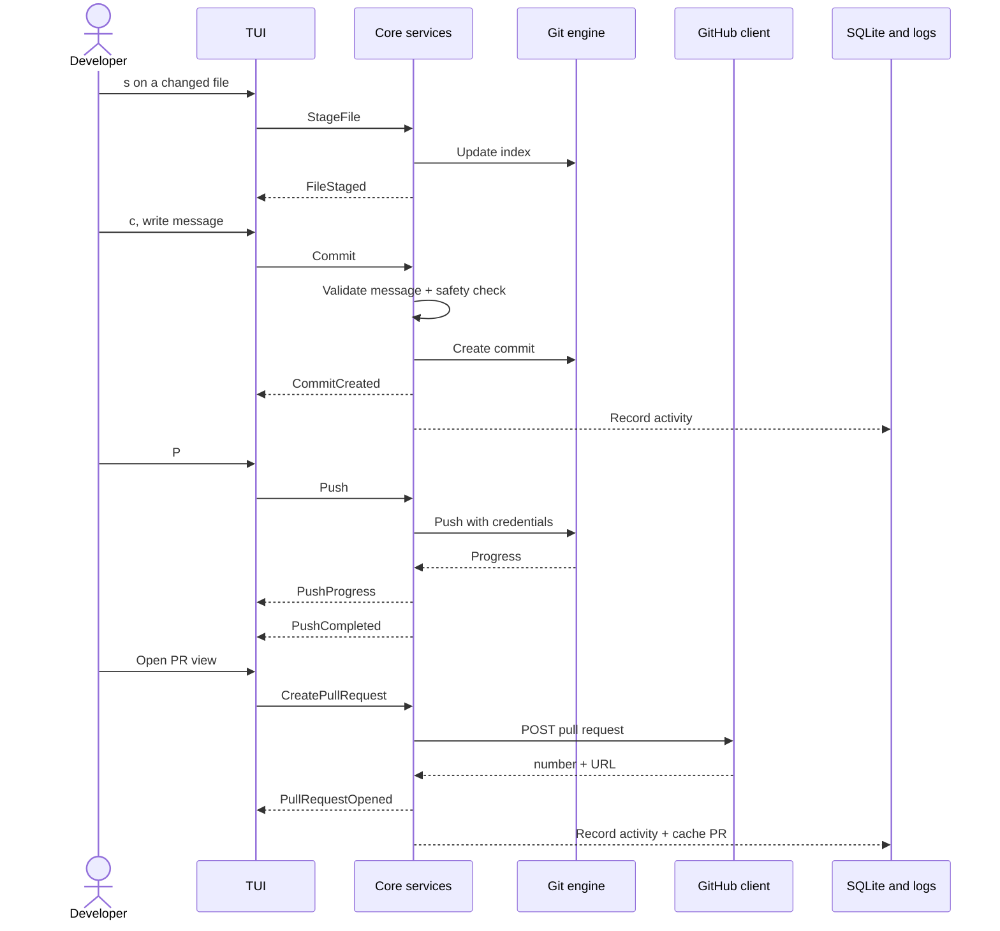

# 10 — Roadmap, Phases & MVP Acceptance

Phases 1–6 = **MVP**. Phases 7–8 are post-MVP; MVP code must simply **not block them** (stable event schema, snapshot model, no terminal-only assumptions in core).

## Phase table with exit criteria

| # | Phase | Scope | Exit criteria |
|---|---|---|---|
| 1 | Foundation | Workspace, crate boundaries, traits, errors, CI, repo discovery, `GitBackend` read ops, `forge status` | `forge status` correct on fixture repos across 3 OSes in CI |
| 2 | TUI shell | Ratatui loop, panes, navigation, status + diff views, contextual footer, resize handling | Snapshot tests pass; usable at 80x24; terminal restored on panic |
| 3 | Core Git workflows | Stage/unstage (file, hunk), commit, branches, history, fetch/pull/push, `SafetyService` | Full edit → stage → commit → push loop works against a local bare remote |
| 4 | Local state | SQLite, migrations, projects, favourites, activity log, `config.toml`, keymap overrides | State survives restarts; corrupt DB recovers cleanly |
| 5 | GitHub | Device-flow auth, API client, caching, PR list/view/create, checks | Open a PR from Forge on a real repo; offline cache works |
| 6 | Polish & release | Guide, async progress + cancellation, error copy, accessibility, packaging, docs, `forge doctor` | Public beta with prebuilt binaries and README demo |
| 7 | Extensions | Stable event schema, plugin protocol, Python SDK, 2–3 official plugins | Third-party plugin runs sandboxed with declared permissions |
| 8 | Forge World | Repo graph renderer + learning mode on core events | Read-only world view driven entirely by public core APIs |

## Task checklists (for agents; tick as done)

### Phase 1 — Foundation
- [ ] Cargo workspace with six crates; enforce dependency direction (CI check, e.g. `cargo deny` bans or a script)
- [ ] `forge-core`: domain models, typed errors, event enums, traits, in-memory fakes
- [ ] `forge-git`: `open`, repo discovery (subdir → root), `status`, `log`, `branches`, kind detection (normal/worktree/bare/submodule/in-progress)
- [ ] `forge-cli`: `forge status` (text + `--json`), `--repo`, `--no-color`, exit codes
- [ ] Fixture builder (temp repos incl. conflict, detached HEAD, unborn)
- [ ] CI: fmt, clippy `-D warnings`, test on Linux/macOS/Windows
- [ ] ADR folder + templates

### Phase 2 — TUI shell
- [ ] App loop (crossterm events + tick), terminal guard (restore on panic/signal)
- [ ] View-model layer separated from widgets
- [ ] Three-pane layout + responsive collapse (100 / 70 col breakpoints)
- [ ] Header, contextual footer, toast area
- [ ] Changes list + diff view (lazy, size limits, binary handling)
- [ ] `?` help overlay from the shared help source
- [ ] `TestBackend` snapshots at multiple sizes

### Phase 3 — Core Git workflows
- [ ] Stage/unstage file; hunk staging (D8 prototype); line select
- [ ] Commit (message validation, editor fallback, hooks via CLI, amend unpushed)
- [ ] Branch create/switch/rename/delete/merge with dirty-tree handling
- [ ] History view (paged log + commit detail + per-commit diff)
- [ ] Fetch/pull/push with progress + cancellation; rejected-push guidance; set-upstream flow
- [ ] `SafetyService` + recovery snapshots + confirmation UI
- [ ] Integration test: edit → stage → commit → push to a local bare remote

### Phase 4 — Local state
- [ ] `forge-storage`: migrations runner, schema 0001, corrupt-DB recovery
- [ ] `ProjectService`: recent/favourites, prune missing, `forge projects` + project browser
- [ ] Persist last view/branch/file; restore on open
- [ ] Activity recorder consuming events; retention
- [ ] `config.toml` loader with defaults, warnings, keymap overrides

### Phase 5 — GitHub
- [ ] `SecretStore` (keyring) + env/`gh` fallbacks + explicit headless error
- [ ] Device-flow login/logout; expiry → re-login prompt
- [ ] `ForgeHost` GitHub impl: user, repo, PR list/detail/create, review summary, check runs
- [ ] ETag cache + stale-while-revalidate + offline markers; rate-limit backoff
- [ ] PR views in TUI; `forge pr list|view|create` (+ `--json`); checkout PR branch

### Phase 6 — Polish & release
- [ ] Onboarding guide + `guide_progress`; `forge help TOPIC`
- [ ] Error-copy pass (every error has what/why/next)
- [ ] Accessibility themes; `NO_COLOR`
- [ ] `forge doctor`
- [ ] Packaging (cargo-dist), completions, man page, README demo, signed checksums
- [ ] Perf benchmarks vs targets

## MVP scope & acceptance criteria

| Capability | Acceptance criterion |
|---|---|
| Launch & discovery | `forge` works inside a repo (opens it) and outside (project browser); subdirectories resolve to repo root |
| Auth | Login via device flow, logout, re-auth on expiry; token only in the keyring |
| Status & diff | Staged, unstaged, untracked, conflicted files shown; text diffs render; binary/oversized files handled gracefully |
| Staging & commits | File and hunk staging; commit with message validation; amend last unpushed commit |
| Branches | List, create, switch, rename, delete with safeguards; dirty-tree switch handled |
| Remote | Fetch, pull, push with live progress and cancellation; rejected push explained with next steps |
| History | Paged commit log with commit detail and per-commit diff |
| Pull requests | List, view, create from current branch, show check status, open in browser |
| Local state | Recent projects, favourites, last-view restore via SQLite |
| Guide & help | First-run onboarding, contextual footer, `?` overlay, `forge help` |
| Quality | Integration tests on temp repos; clean terminal restore on crash; works at 80x24 |

**Explicitly out of MVP:** interactive rebase, stash management UI, submodule management, issues and Actions logs, multi-host support, plugins, Forge World.

## Core workflow sequence (reference)

## Learner journey (guide design target)

Setup (install/run, login, pick project) → Learn the loop (see changes, stage, commit, push) → Collaborate (open PR, check status). Target: **first PR from install in a single short session.**
