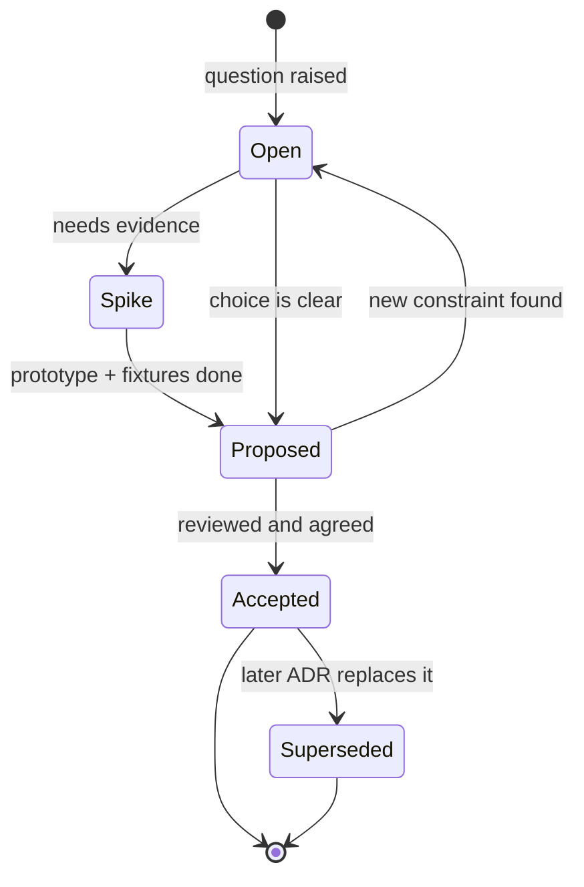

# 11 — Decision Register

Status: **Proposed** (recommendation, not final) · **Open** (undecided) · **Accepted**. Promote accepted rows to formal ADRs in `docs/adr/` (template: `docs/adr/0000-template.md`).

| ID | Decision | Options | Proposed choice & rationale | Revisit if | Status |
|---|---|---|---|---|---|
| D1 | Core language | Rust, Go, TypeScript | **Rust** — single native binary, strong TUI ecosystem, memory safety | Contributor pool/build times block | **Accepted** |
| D2 | Git access | git2 only, CLI only, hybrid | ~~Hybrid~~ → **System `git` CLI only, via argument arrays** (user decision 2026-10-10, ADR 0001) | libgit2 closes gaps, or CLI parsing proves fragile | Proposed |
| D3 | GitHub auth type | OAuth App device flow, GitHub App w/ expiring tokens, PAT only | Evaluate **GitHub App** first (finer perms, expiring tokens); keep PAT + `gh` token fallbacks | Device-flow limits / org approval friction | Open |
| D4 | GitHub client | hand-rolled reqwest, Octocrab | Start **reqwest** + small typed surface; adopt Octocrab if upkeep gets costly | API surface grows past PRs + checks | Open |
| D5 | Local storage | SQLite, JSON files, embedded KV | **SQLite** — queryable activity + cache, proven, tiny | Never expected | **Accepted** |
| D6 | Secrets storage | OS keyring, encrypted file, plaintext | **OS keyring**; env-var fallback; **no silent plaintext** | Headless Linux demand justifies encrypted file | **Accepted** |
| D7 | Hook handling | ignore, always run, setting | **Run by default via CLI, setting to disable, surface when a hook executes** — implemented on the Commit screen: hooks always run unless the per-commit `skip hooks` toggle (`--no-verify`, off by default) is on; installed hooks are listed and their output streamed (user decision 2026-10-10) | Security concerns with untrusted repos | Proposed |
| D8 | Hunk/line staging | git2 apply to index, patch + `git apply` | **One-hunk patch + `git apply --cached`** (ADR 0001); line-level staging later | Fixture tests show apply failures on real repos | Proposed |
| D9 | Undo/recovery | none, reflog hints, Forge snapshots | **Forge snapshot refs** before destructive local actions, pruned by age/count — implemented for discard (ADR 0002); pruning and Undo list not built | Too costly on large/binary repos | Proposed |
| D10 | Concurrency | single-thread, thread pool, Tokio + blocking pool | **UI thread + Tokio I/O + bounded blocking pool for libgit2** | Profiling shows contention | Proposed |
| D11 | Plugin runtime | embedded Python, out-of-process JSON-RPC, WASM | **Out-of-process JSON-RPC** — crash isolation, no interpreter in core, permission boundary | Latency-sensitive plugins appear | Proposed |
| D12 | Plugin transport | stdio, local socket | **stdio** first | Need multiple concurrent clients | Open |
| D13 | Platform support v1 | Linux+macOS only, all 3 full, Windows beta | All three in CI from day one; decide if Windows ships beta | Terminal bugs consume schedule | Open |
| D14 | Host abstraction | GitHub-only code, trait | **`ForgeHost` trait now**, GitHub sole impl | Abstraction slows MVP | Proposed |
| D15 | Telemetry | none, opt-in, opt-out | **None by default**; any future analytics opt-in + documented | Need crash reporting at scale | Proposed |

## Additional open items (from the spec)

- [ ] Name collision check and licensing (MIT/Apache-2.0 dual vs other)
- [x] Recovery snapshots: `refs/forge/snapshots/` commits built from a temporary index (ADR 0002, links D9)
- [ ] Whether the integrated guide uses a sandbox repo in MVP or post-MVP

## Design-canvas screens deferred (out of MVP)

The "Forge — Design Concept" canvas includes screens that `docs/10-roadmap-and-mvp.md` places outside the MVP. On 2026-10-10 the user chose to skip them and record them here instead of building them:

| Artboard | Why deferred | Revisit when |
|---|---|---|
| 06 · Actions — live CI log | Issues & Actions logs are out of MVP | Post-MVP phase that adds GitHub checks beyond a status chip |
| 20 · Plugin marketplace | Plugins are post-MVP (`docs/12-future-extensions.md`, D11/D12) | Plugin runtime ADR is accepted |
| 21 · Plugin install & installed list | Same as 20 | Same as 20 |

Until then, the Changes nav omits Actions, and no plugin entry points appear in the TUI.

## How an agent should handle Open/Proposed decisions

1. Implement behind a trait, feature flag or setting so the choice is reversible.
2. Write `docs/adr/NNNN-title.md` with status **Proposed**, the option you chose, the evidence (fixture results, benchmarks) and the "revisit if" trigger.
3. State it explicitly in your change summary. Don't silently pick, don't block waiting.

## Decision lifecycle

