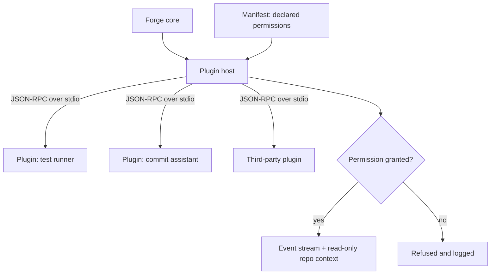

# 12 — Future Extensions (Post-MVP) & Constraints on MVP Code

> **Do not build any of this in the MVP.** This doc exists so MVP code *doesn't block it*.

## Plugin architecture (Phase 7)

- **Out-of-process by default.** Plugins are separate Python processes talking to Forge over a **versioned JSON-RPC** protocol on **stdio** (or a local socket — D12). Isolates crashes; no interpreter embedded in core.
- **Event subscriptions.** Plugins declare which events they want; Forge streams them with repository context.
- **Capabilities & permissions.** A manifest declares what a plugin may do: read repo state, run processes, access network, modify repo, add UI panels. Forge prompts on first use and enforces the declared set at the boundary.
- **Contribution points:** custom commands, command-palette entries, footer actions, status-bar widgets, extra panes, themes, keymaps.
- **Stability contract:** explicit version numbers + deprecation policy on the event schema and plugin protocol.

**Candidate first-party plugins:** test runner (pytest, cargo test, npm test) · lint/format (Clippy, Ruff, ESLint, Prettier, rustfmt) · Conventional Commit validator/assistant · PR summary assistant · Actions/checks visualiser · issue-tracker links · time tracking/statistics.

## Forge World (Phase 8)

A *consumer* of the same repository-state API and event stream — **not a fork of core logic.**

- **Concept:** repository as a navigable world — branches as paths, commits as landmarks, merges as junctions, PRs as bridges to the remote.
- **Modes:** read-only graph explorer first; then a learning mode with guided challenges (resolve this conflict, rebase this branch) on sandbox repos.

## What this requires from the MVP (do these now)

1. **Stable repository snapshot model** in `forge-core` (commit graph, refs, working-tree summary) — serialisable.
2. **Versioned, serde-serialisable, replayable events** (doc 06).
3. **No terminal-only assumptions in `forge-core`** (no ANSI/ratatui types in core models).
4. Services callable without a TUI (already required by the CLI).
5. Extension points that are cheap to add later: command registry, footer-action registry, theme/keymap loading from `config.toml`.
6. A single help-content source that plugins could later contribute to.

## Host abstraction (GitLab/Bitbucket later)

`ForgeHost` trait with GitHub as the only impl. Keep PR/check domain models host-neutral; keep GitHub JSON shapes inside `forge-github`.
